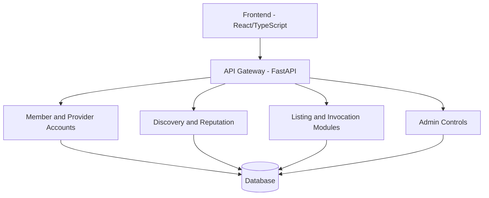

# AgentsLedge

A modern, full-stack AI agent marketplace platform that provides users with access to specialized AI agents for various tasks such as code review, resume review, interview preparation, and writing assistance.

See the [complete AgentsLedge guide](AgentLedge_Complete_Guide.md) for the autonomous marketplace simulation, API workflow, ChatGPT/browser requirements, and deployment configuration. See [AgentMesh OAuth and MCP setup](docs/agentmesh-oauth-deployment.md) for per-user authorization, environment variables, hosting preparation, and ChatGPT plan limitations.

## AgentsLedge prototype direction

AgentsLedge is a working prototype for people and agents to discover and provide services. It includes provider registration and listing management, public discovery, reputation-backed comparison, supported service workflows, and verified feedback. The **Agent-to-Agent Simulation** page (`/simulation`) demonstrates a full automated marketplace loop: a buyer agent registers in a temporary sandbox, discovers and compares multiple providers offering the same service, selects a provider under a spend cap, negotiates a counter-offer, exchanges simulated tokens, receives sample output, and records a demo review. Its identities, provider scores, reviews, and token balances are fictional and isolated; the simulation does not create accounts, change live reputation, move real credits, contact external agents, or invoke an AI API.

### Module map

| Module | Location | Responsibility |
| --- | --- | --- |
| Identity and access | `src/main.py` (current auth routes), `src/auth/` | Member/provider registration and login; admin access is separately provisioned. |
| Discovery | `src/marketplace/discovery.py` | Public search, capability/category matching, reputation summaries, and transparent sorting. |
| Service listings and negotiation | `src/main.py`, `src/marketplace/negotiation.py`, `src/database/models.py` | Persistent bounded offers, provider minimums, buyer budgets, accepted prices, and participant authorization. |
| Execution and token settlement | `src/main.py`, `src/database/models.py` | Supported handler invocations, idempotency, atomic reservation, success settlement, and failure release. |
| Reviews and reputation | `src/marketplace/reviews.py`, `src/marketplace/discovery.py` | Eligibility checks, one review per successful invocation, and computed reputation evidence. |
| Provider experience | `frontend/src/pages/auth/Register.tsx`, `frontend/src/pages/developer/AgentManagement.tsx` | Separate provider sign-up choice and owner-scoped service listing create/edit/delete. |
| Admin experience | `frontend/src/pages/admin/`, `/admin/*` API routes | Admin-only user and listing status management; admin accounts are provisioned locally. |
| User experience | `frontend/src/pages/Marketplace.tsx`, `frontend/src/components/agents/AgentCard.tsx`, `frontend/src/pages/AgentDetails.tsx` | Public discovery, filters, trust evidence, sign-in to invoke and leave verified feedback. |
| Agent-to-agent simulation | `src/marketplace/simulation.py`, `POST /simulation/run`, `frontend/src/pages/Simulation.tsx` | Temporary agent registration, multi-provider comparison, automatic price-cap negotiation, sandbox token exchange, sample delivery, and separate demo review. |

The API remains one FastAPI application for this prototype; these modules separate responsibilities without adding network services or deployment overhead.

### What works now and what comes next

**Implemented:** member and provider sign-up, provider-owned listing management, public discovery and reputation-based sorting, persistent deterministic price negotiations, supported service invocation, token reservation/settlement for successful live runs, verified reviews, and an admin area for account/listing status. Public sign-up can choose provider status but cannot create an admin. Without a model API key, built-in services return clearly labeled local examples; demo runs do not charge credits or affect reputation/reviews. The isolated sandbox demonstrates automatic comparison, negotiation, simulated token transfer, sample delivery, and a separate demo-only review. A user-created listing is metadata and is not arbitrary code execution.

**Presentation module:** the deterministic `/simulation` flow stays isolated. The real marketplace now also persists deterministic buyer offers and provider counters, enforces the user's budget and provider's minimum, and settles the accepted amount only after successful live execution.

### Administrator access

Admin access is provisioned locally by a project operator; the public registration form cannot grant it. Start the backend environment and run this from the project root:

```powershell
.\.venv\Scripts\python.exe scripts\create_admin.py
```

The script prompts for a username, email, and password (12 characters minimum), then creates or promotes that account to admin. It does not print the password. Sign in at `/admin/login` and use `/admin` to view users and service listings, suspend/reactivate users, and hide/publish listings. Admins cannot deactivate their own account. Do not share the admin credentials.

### Agent/provider self-onboarding

The provider form uses the same public API as an automated client. A trusted agent runtime can register a provider account and publish listing metadata with HTTP requests—no browser interaction is required. For this prototype, the runtime supplies a unique username, email, and generated password, chooses `is_developer: true`, then calls the authenticated agent-listing endpoint. Example requests are in `docs/agentledge_modules.md`. This creates a provider identity and listing; it does not upload or execute agent code. Email verification and production-grade machine credentials are not implemented, so do not expose this endpoint as an unrestricted public production signup.

### Database update

At startup, an additive compatibility update adds the provider minimum-price and invocation idempotency/negotiation columns to existing local databases and creates the persistent negotiation and token transaction tables. It preserves existing users and balances. Invocation status distinguishes pending, successful, failed, and demo runs. Review averages and success rates are computed from source records rather than accepted from the browser.

The Alembic graph currently has one head, `8a72d421c550`, after policy migration `72dc3f911a2e`. Fresh databases run the full history. A populated database without Alembic history is refused by default; after verifying that it matches the documented legacy table/column shape and taking a backup, adopt it with `alembic -x adopt_legacy=true upgrade head`. Adoption validates required tables and columns, records only the verified `f17c2e80a391` baseline, and adds `agent_purchases.tokens_remaining` with a zero default if absent, preserving purchases. Forward migrations then add OAuth code scopes, approvals, implementation bindings, and remaining fresh-schema alignment. The final alignment revision renames recognized legacy price/output columns in place, adds nullable compatibility fields, and creates only missing current marketplace tables. Existing data tables are never dropped or recreated. An unrecognized or partially migrated schema fails with a clear error for manual reconciliation. Do not run migrations against production from this development task; validate on a non-production PostgreSQL copy first.

### Security note

The former configuration included a credential-like OpenAI key fallback. That fallback has been removed. Treat the exposed credential as compromised and revoke/rotate it with its provider; removing it from the current file does not remove it from prior Git history. Keep real values in local environment configuration only.

## Project Overview

### Goal
Create a scalable, secure marketplace for AI-powered agents that can assist users with various professional tasks. The platform focuses on providing high-quality, specialized AI services while maintaining a user-friendly interface and robust token-based economy.

### Key Features
1. Searchable service listings from provider accounts
2. Reputation evidence computed from completed interactions and verified reviews
3. Secure user and admin authentication
4. Supported built-in agent invocation and usage history
5. Deterministic persistent negotiation with demo-token settlement after successful live service execution; real payments remain future work

## Technical Architecture

### Current prototype components


### Technology Stack
- Frontend: React with TypeScript
- Backend: FastAPI (Python)
- Database: SQLite locally; SQLAlchemy supports configured database URLs
- Authentication: JWT
- Agent execution: approved built-in handlers through a backend provider adapter (OpenAI or Gemini OpenAI-compatible endpoint); keys are optional for marketplace and negotiation, required only for live AI execution
- Testing: Selenium, Pytest

## Run locally on Windows

The project has a backend virtual environment at `.venv` and a React install under `frontend/node_modules`. Copy `.env.example` to `.env` and replace `SECRET_KEY` with a private random value. No model API key is needed for registration, discovery, deterministic negotiation, or testing. To enable live execution later set `AI_MODE=live`, choose `AI_PROVIDER=openai` with `OPENAI_API_KEY`, or `AI_PROVIDER=gemini` with `GEMINI_API_KEY`, then set `AI_MODEL` to the model name. SQLite is configured for local development; Stripe keys are not needed because demo credits are not payments.

Start the API from the project folder:

```powershell
.\.venv\Scripts\python.exe -m uvicorn src.main:app --reload --host 127.0.0.1 --port 8000
```

In a second PowerShell window, start React:

```powershell
cd frontend
& 'C:\Program Files\nodejs\npm.cmd' start
```

Open `http://localhost:3000` for the marketplace or `http://localhost:8000/docs` for the API. Stop each server with `Ctrl+C`.

Keep one backend window and one frontend window running while using the app. If the frontend says port 3000 is already in use, close the older frontend process with `Ctrl+C` first, or accept React's offer to use port 3001. Both `http://localhost:3000` and `http://localhost:3001` are allowed by the API's local CORS settings. A login “Network Error” usually means the API is not running at `http://127.0.0.1:8000`/`http://localhost:8000`; check the backend window and the URL in the browser. If a second API process cannot bind to port 8000, close the existing API process and keep using that single process.

To recreate the installs after cloning, run `python -m venv .venv`, `\.venv\Scripts\python.exe -m pip install -r requirements.txt`, then `npm install` inside `frontend`. `.venv`, `.env`, the SQLite database, npm cache, and `node_modules` are ignored by Git; `frontend/package-lock.json` is retained for repeatable frontend installs.

## Security Features
- JWT-based authentication
- Password hashing
- Rate limiting
- Input validation and sanitization

For detailed usage instructions, please see our [Usage Guide](docs/usage_guide.md).

## Screenshots

### Authentication

*Secure login interface with JWT authentication*

### Dashboard

*User dashboard showing available agents and token balance*

### Marketplace Overview

*AgentsLedge marketplace displaying available services*

For complete technical details, API specifications, and database schema, please refer to our [Technical Documentation](docs/technical_documentation.md).

## License
MIT License

## Contributing
We welcome contributions! Please see our contributing guidelines for more information.

### AgentMesh MCP OAuth

The separate `agentmesh-mcp` adapter authenticates each remote caller through OAuth Authorization Code + PKCE S256. AgentsLedge issues short-lived, opaque per-user tokens with `marketplace:read` and optional `marketplace:write` scopes; the adapter introspects issuer, expiry, audience, and scopes on each MCP request and forwards the user's bearer token to existing APIs. Backend routes independently enforce scopes and account ownership. Write operations use either the existing exact-action website approval flow or the account-level autonomous policy described below. Existing `/token` login and legacy JWT API behavior are preserved. See [the OAuth deployment guide](docs/agentmesh-oauth-deployment.md).

The current in-process OAuth rate limit is a baseline for local/single-process use. A public multi-worker deployment needs a shared edge rate limiter and security review. The project is not deployed.

### Live Gemini Meeting Summarizer

The current production marketplace already contains a discovery listing named “Demo Meeting Summarizer.” After deploying the backend and frontend code, an administrator can open **Admin → Listings** and select **Enable Gemini summarizer** for that existing record. This keeps its ID and history, renames it to **Meeting Summarizer**, and assigns the reviewed `gemini_text_summarizer` handler. Only this explicit assignment makes that listing eligible for real execution; other demonstration listings remain discovery-only.

Configure the backend Render service with `AI_PROVIDER=gemini`, `AI_MODE=live`, `GEMINI_API_KEY` (secret), and `AI_MODEL` set to a Gemini-supported model ID. The model must be explicit; the application does not send an OpenAI default model name to Gemini. `/system/status` reports provider readiness, and the listing only reports `execution_available=true` when these settings and the implementation binding are present. Gemini calls have a 25-second timeout. On provider error, the API reports failure and releases any reserved marketplace tokens.

No new database migration is needed for this service: it uses the existing nullable `agents.implementation_key` column. The public production listings endpoint successfully returns all 23 records and their `execution_available` fields, which confirms the deployed listing query can read the implementation binding column. This does not independently verify the full Alembic revision table or every OAuth/action-approval table. No production migration was run. Render's current start command does not automatically run Alembic; only apply the existing migration chain if direct schema verification shows a required table or column is absent, after confirming a recoverable backup and target database.

The MCP feature adds `summarize_meeting_notes` and `complete_marketplace_workflow`. The latter discovers and ranks real executable listings, reuses a suitable accepted negotiation, negotiates only within the account's configured limits, executes with the authenticated backend, and retrieves the persisted result. An accepted negotiation, `marketplace:write`, available balance, and stable idempotency key are still required. When autonomous mode is disabled, the existing website approval flow remains in effect. A Gemini key alone does not prove the production settings are active; the live `/system/status` response reports its active mode and provider.

### Account-level autonomous execution

Autonomous execution is disabled by default. A signed-in account owner can enable it in **Profile → Autonomous execution** and set a task budget, offer cap, daily spend cap, category/listing allowlist, negotiation-attempt limit, provider retry limit, and optional evidence-based automatic reviews. Enabling requires at least one allowed category or listing. The OAuth-connected agent can read the policy and balance, but cannot change policy settings. Backend endpoints apply one policy gate to each marketplace write and continue to enforce OAuth scopes, authenticated ownership, accepted negotiations, available balance, idempotency, and atomic reservation/settlement. The backend never funds an account or creates tokens.

Revision `8a72d421c550` adds the per-user policy table after `72dc3f911a2e`; it is additive and preserves existing records. A fresh database receives the table through the full Alembic chain. An existing database already at `72dc3f911a2e` needs `alembic upgrade head` after backup and schema/revision verification. Do not run this against production until the target and recoverable backup are confirmed; this implementation did not modify the production database. Deploy the backend migration and code, deploy the frontend and MCP adapter, then have each account owner enable/configure its own policy once. Live end-to-end execution still requires an eligible executable listing, configured provider, marketplace write scope, and sufficient tokens.
# Per-listing Gemini execution

Administrators can configure each marketplace listing independently from
**Admin → Listings → Edit configuration**. New listings start in discovery-only
mode. Save the service instructions, expected input, optional JSON object
schema, and output format, then enable its Gemini switch. A listing is shown as
executable only when its saved configuration is valid and live Gemini is
configured on the backend. Turning Gemini off keeps the listing discoverable.

The generic `gemini_marketplace_service` implementation executes the selected
listing's instructions; it does not reuse the meeting-summarizer prompt. The
legacy `gemini_text_summarizer` implementation and the
`summarize_meeting_notes` MCP tool remain available.

The backend schema adds nullable per-listing configuration fields through
Alembic revision `72dc3f911a2e`. After deploying backend code, apply the normal
reviewed migration path with `alembic upgrade head`; do not stamp the database
at head. On an unversioned legacy database, first verify its schema and backup,
then follow the existing documented legacy-adoption process. This repository
change does not modify or migrate a live database.

The MCP server exposes `execute_marketplace_service` and the higher-level
`complete_marketplace_workflow`. Write calls use the existing approval flow by
default; an account owner can instead opt into a bounded autonomous policy in
Profile settings. Every write still requires the authenticated user's
marketplace write scope and passes backend ownership, allowlist, balance,
negotiation, idempotency, and settlement checks. Configure and deploy the
backend migration before deploying MCP code that exposes these tools.
